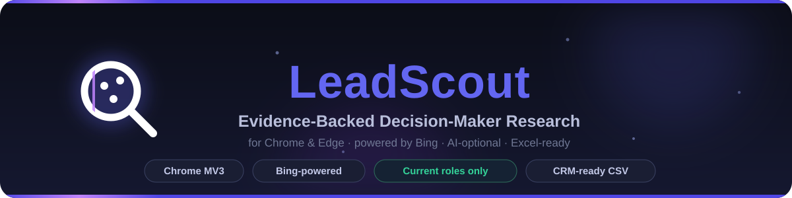

<div align="center">



# LeadScout

**Research 50–100 companies in one run. Get decision-makers — current roles, verified profile links, emails — straight into Excel as TSV.**

A Chrome / Microsoft Edge extension that replaces the one-company-at-a-time chatbot workflow for B2B lead research.
Runs in your browser · Bing + company-owned pages · works without any API key · free AI keys optional.

[](https://developer.chrome.com/docs/extensions/)
[](https://www.microsoft.com/edge)
[](https://github.com/siddhant-pardeshi/LeadScout/releases)
[](#-testing--quality)
[](LICENSE)
[](https://www.bing.com)

</div>

<div align="center">

</div>

---

<div align="center">

</div>

## What LeadScout does

You have a list of companies. You need the people who can say yes to AI, software, automation or digital-transformation work.

1. **Paste the list** — LinkedIn company URLs, plain company names, or a mix, one per line.
2. **LeadScout researches each company separately** — its own Bing searches, its own LinkedIn page read, its own optional AI call. Names cannot bleed from Company A into Company B.
3. **You get an Excel-ready table** — name, designation, country, company, size, industry, LinkedIn URL, email, status, priority, HQ and more.

## Why the output is trustworthy

Four rules are enforced in code, not just promised in a prompt:

| Rule | What it means |
|---|---|
| **Real URLs only** | A LinkedIn profile link is kept only when it came from a real search result for that company. LeadScout never builds a profile URL from a name. |
| **AI names must be grounded** | An AI-proposed person is kept only when their name appears in that company's own search results. The role is re-derived from that result — not from the model's claim. Invented names are dropped and counted. |
| **Current roles only** | `Former`, `Ex-`, `was`, `previously` and dated past roles are dropped or flagged. A past CEO never becomes today's CEO. |
| **Emails are honest** | Hunter.io-verified addresses are marked verified. Pattern guesses are labelled `estimated — unverified`. With no source, the cell stays empty. |

<div align="center">

</div>

---

## Install

### Google Chrome

1. Open `chrome://extensions`
2. Turn on **Developer mode** (top-right)
3. Click **Load unpacked** → select this folder
4. Pin **LeadScout** from the puzzle-piece menu

### Microsoft Edge (the browser where Bing is the default)

Edge is Chromium-based, so the same build runs unchanged — no separate package, no Chrome-only APIs.

1. Open `edge://extensions`
2. Turn on **Developer mode** (left sidebar)
3. Click **Load unpacked** → select this folder
4. Pin **LeadScout** from the extensions menu

> “Bing browser” usually means Microsoft Edge with Bing as the search engine. Extensions are not supported in the Bing mobile app; install LeadScout in Edge on desktop.

### After installing

- Stay logged into LinkedIn in the same browser profile (the company-page facts are much better).
- Optional: open ⚙ **Settings → 🔑 API keys** and save a free Groq/Gemini key.
- Paste companies → **▶ Start research** → **Copy TSV** → paste into Excel.

Standard mode takes about 15–25 seconds per company. The queue runs in the background worker, so you can close the popup and keep browsing.

---

## 🔑 API keys — saved permanently, with an expiry date

Stop pasting the same key on every run.

Open **⚙ Settings → 🔑 API keys**:

| Control | What it does |
|---|---|
| **Paste + Save** | Saves that one key immediately to `chrome.storage.local`. No need to press “Save settings”. |
| **Status pill** | Shows `saved · no expiry`, `saved · expires 24 Dec`, or `saved · expired 20 Nov` at a glance. Hover for the full saved date and last check result. |
| **Expiry / rotation date** | Optional date you choose. LeadScout warns you in the popup **30 days before** it passes, and shows the exact date. |
| **Show keys** | Reveals all key fields so you can confirm what is stored. |
| **Test key** | Saves the current field first, then calls the provider and records “last checked”. |
| **✕ (click twice)** | Removes the saved key from this browser. |

### Why you set the expiry date

Groq, Gemini, OpenRouter and Hunter **do not publish a key-expiry date**. Inventing one would be worse than showing nothing. LeadScout therefore stores:

- **Saved on** — the date you saved the key (set automatically)
- **Expires / rotate on** — an optional date you control
- **Last checked** — updated when **Test key** succeeds or fails

If you leave the date empty, the pill says `no expiry` — honest, not a fake date.

### Where the keys live

- Stored in **`chrome.storage.local`** — this browser profile only.
- Survive browser restarts, extension reloads and extension updates.
- **Not synced** between Chrome and Edge (they are separate browser profiles). Save once in each browser you use.
- Removed only when you clear the key, clear extension data, or uninstall the extension.
- Sent only to the provider you call (as the `Authorization` header). LeadScout has no server and no telemetry.
- Not additionally encrypted at rest: they sit in the browser profile, protected by your OS account. Use a locked OS account on shared machines.

Existing keys from older versions load automatically; their saved date is recorded the next time you press **Save** for that key.

| Provider | Free key | Used for |
|---|---|---|
| **Groq** | [console.groq.com](https://console.groq.com) | fast structuring / enrichment |
| **Gemini** | [aistudio.google.com](https://aistudio.google.com) | web-grounded recovery for thin results |
| **OpenRouter** | [openrouter.ai](https://openrouter.ai) | free Llama models |
| **Hunter.io** | [hunter.io](https://hunter.io) | verified emails (free tier ≈ 25 domain searches/month) |
| **Custom** | your endpoint | any OpenAI-compatible API |

No key at all? LeadScout still works from public Bing results and company-owned leadership pages, with the same TSV and fewer filled facts.

---

## ✨ Every feature, in plain language

### 🔍 Research engine
| Feature | What it means for you |
|---|---|
| **Bulk input** | Paste 50–100 companies at once — URLs, names, or mixed lines (`Postman - https://…`). Duplicates are removed. |
| **3-tier name resolution** | Typed a name? LeadScout guesses the LinkedIn slug and verifies it by loading the page, then falls back to scored Bing results. A guess is never accepted unless the page name matches. |
| **Source-aware recovery** | If Bing does not index a usable LinkedIn profile, LeadScout can read the company's own leadership/management page directly. It labels the row **Official**, links the evidence URL, and never invents a profile URL. |
| **Per-company isolation** | Each company gets its own search corpus and AI call. The classic bulk-research bug — Company A's CEO appearing under Company B — is structurally prevented. |
| **Deep page scan** | Reads LinkedIn's `/about/` page for industry, company size, HQ and website, with retries for slow rendering and a guest-mode fallback. |
| **3 scan depths** | Quick (1 search), Standard (2), Deep (4) — roughly 10 s to 40 s per company. |
| **⟳ Refresh all** | Re-runs every company so names, roles, facts and emails reflect the live web now. |

### 👤 People and designations
| Feature | What it means for you |
|---|---|
| **Current roles only** | Past-role markers are dropped, position-aware: “Acme engineer, previously at Google” is kept; “Former CEO at Acme” is not. |
| **P1–P5 priority** | P1 = C-suite / founders / CTO / CIO / Chief AI; P2 = heads of Product, Engineering, AI, Digital; down to managers. |
| **Smart title parsing** | Handles `Jane Doe - CEO at Acme | LinkedIn`, `Jane Doe CEO at Acme`, affiliation-only rows and junk rows. |
| **AI enrichment (optional)** | Groq / Gemini / OpenRouter / custom endpoint. **Corpus-gated:** ungrounded names are dropped; the role comes from the evidence. |
| **Gemini web grounding** | When a company yields thin results, Gemini performs real Google-search grounding to recover people and facts. |

### 📧 Emails
| Feature | What it means for you |
|---|---|
| **Hunter.io (optional)** | Matches each person to verified emails for the company domain, or Hunter's verified domain pattern. |
| **Pattern estimates** | No Hunter key? `first.last@domain` plus alternates, always labelled `estimated — unverified`. |
| **Never fabricated** | No verified source → empty cell. LeadScout will not invent an address. |

No second Apollo extension is required. If you already have Apollo, keep it — LeadScout does not need it.

### 📋 Excel export
| Feature | What it means for you |
|---|---|
| **One-click TSV** | Copies the full 16-column table; paste straight into Excel. |
| **16 columns** | Name · Designation · Country · Company Name · Company Size · Industry · LinkedIn URL · Email · Email Status · Role Currency · Priority · Verification · HQ · Company Page · **Evidence URL** · **Source Type**. |
| **Core 7-column mode** | Exactly the classic research template: Name, Designation, Country, Company, Size, Industry, LinkedIn URL. |
| **Filter-aware export** | Filter to C-Suite or Verified-only, then copy exactly that. |
| **TSV / CSV download** | CSV includes a UTF-8 BOM so “José García” opens correctly in Excel. |

### 🎛 Queue and comfort
- Live progress, people/verified/company counts and ETA.
- Pause / Resume / Stop / **Retry failed** / **Refresh all**.
- Bing captcha or consent screen? LeadScout pauses, notifies you, and resumes after you complete it yourself.
- Empty results now say whether Bing returned no profiles, candidates failed the current-role/company checks, or search parsing was blocked — rather than silently calling every case manual review.
- Chrome/Edge kills the background worker? The queue resumes automatically, and a health banner tells you if a reload is needed.
- Dark and light themes; full-page results view with filters.

---

## 🧭 Verification labels

| Label | Meaning |
|---|---|
| 🟢 **Verified** | The LinkedIn URL came from a real search result or Gemini citation for that company — never constructed. |
| 🟢 **Official** | A current name and role are stated on the company's own durable leadership/governance page; the results table links that evidence when no LinkedIn profile was indexed. |
| 🟢 **CURRENT** | The role at this company is title-verified. |
| 🟡 **SNIPPET** | The company appears in the snippet and there are no past-role markers. |
| 🟡 **Unverified** | A real person from search results, but no pinned profile URL. |
| 🔴 **PAST?** | Contradictory signals — shown for manual review, ranked last. |
| 🔵 `estimated` | Email is a pattern guess — verify before outreach. |

---

## 🌐 Browser compatibility

| Browser | Status | Notes |
|---|---|---|
| **Google Chrome 116+** | ✅ Supported | Primary target |
| **Microsoft Edge 116+** | ✅ Supported | Same MV3 build; `edge://extensions` for loading |
| **Brave / Opera (Chromium)** | ✅ Expected to work | Same extension APIs |
| **Bing mobile app** | ❌ Not applicable | Does not run desktop extensions |

What was done for Edge/Bing compatibility:

- No Chrome-only APIs: only `chrome.storage`, `tabs`, `scripting`, `alarms`, `notifications`, `permissions`, `runtime`, `action`.
- Manifest cleaned for store compatibility: short store-safe name, 120-character description, `homepage_url`, no Chrome-only minimum-version gate.
- Company-site recovery needs to read public company pages, so the manifest declares `https://*/*` host access. It is used only for the company whose website was found for the current row; there is no background browsing, telemetry or server.
- Recovery instructions detect Edge and point to `edge://extensions` instead of `chrome://extensions`.
- A context guard explains what to do if the popup is opened outside an extension context.
- The whole flow was smoke-tested in Edge (load, service worker, popup, key save, reload persistence, expiry warning, clear).

---

## 🔒 Privacy and responsible use

- No LeadScout server, no analytics, no account.
- Searches go to Bing; company pages to LinkedIn or the company's own website; AI requests to the provider whose key you saved; Hunter requests to Hunter.
- The broad `https://*/*` host permission exists so the bounded company-site fallback can read a public leadership page and extract names/roles. It is not used to browse unrelated sites, and the scan stops after a small page budget.
- Keys never leave your browser except as authentication to their own provider.
- LeadScout reads **public search results and public pages you can already see**, at human-like pace, through your own session. It does not mass-scrape employee lists.
- Keep volumes moderate (the built-in pacing exists for a reason) and follow local privacy law (GDPR/DPDP/etc.) when storing or contacting people.

---

## 🏗 Architecture

```
LeadScout/
├── manifest.json        Chrome/Edge MV3 config
├── background.js        queue engine · Bing/LinkedIn readers · pipeline · rate limiting
├── popup.html/.css/.js  main UI · key vault · progress · filters · exports · settings
├── results.html/.js     full-page results view
├── lib/
│   ├── parse.js         pure logic: parsing, resolver, role-currency, TSV/CSV  ← unit-tested
│   ├── keys.js          key metadata: save dates, expiry math, masking        ← unit-tested
│   ├── platform.js      Chrome/Edge detection and context guard
│   ├── rank.js          designation → category/priority                       ← unit-tested
│   ├── ai.js            provider adapters + SSRF-safe URLs
│   ├── verify-lead.js   evidence verifier (cited + dated claims)
│   ├── hunter.js        Hunter.io client
│   └── extract.js       DOM extractors for Bing, LinkedIn and company leadership pages
├── assets/              animated SVG artwork
└── tools/               tests · evidence evaluation · icon/QA helpers
```

Key invariants live in code: profile URLs from real results, AI names grounded in the company corpus, past roles dropped, estimated emails labelled.

---

## 🧪 Testing and quality

```bash
node tools/test.mjs                  # 69 deterministic checks + MV3/ESM smoke tests
node tools/diag_linkcheck.mjs        # standalone import-graph check
node tools/eval-evidence.mjs         # evidence-verifier smoke test
node tools/live-eval-evidence.mjs --offline   # 11-claim comparison
```

The suite covers input parsing, Bing redirect decoding, title extraction, company matching, the 3-tier resolver, role-currency logic, the AI corpus-grounding gate, key/expiry math, Hunter matching and TSV/CSV builders.

**Manual live smoke (24 Nov 2026, Edge 158, no API key):** Twilio → 7 official people; HubSpot → 9; Freshworks → 9; Lupin → 12; Redington → 8; Sun Pharma → 8; Welspun World → 4. Godrej Industries returned **Source blocked** (its site rejects automated access), Jio-bp had no readable leadership page, and a nonexistent company returned `no_profile_results`. Re-verify names and roles against the linked evidence before outreach.

---

## ❓ Troubleshooting

| Symptom | Fix |
|---|---|
| “Background worker failed to start” / status 15 | Open `chrome://extensions` or `edge://extensions` → remove LeadScout → **Load unpacked** again |
| Keys seem missing | Check you are in the same browser profile; Chrome and Edge store separately. Save once per browser. |
| Expiry banner appears | Click it → update or clear the key in Settings → API keys |
| “Bing needs human verification” | Open any Bing tab, solve the check, click **Resume** |
| LinkedIn facts empty | Stay logged into LinkedIn; keep **Read LinkedIn pages** on |
| “model not found” | Settings → AI models → set the provider's current model id |
| **No profiles** / **Review** | Bing returned no matching profiles or the candidates did not pass company/current-role checks. Hover the reason for query and rejection counts; try **Deep** mode or paste the exact LinkedIn URL. |
| **Search blocked** | Open the LeadScout Bing tab, complete Bing's consent or human-verification screen yourself, then click **Resume**. |
| **Search error** | Reload the extension from `chrome://extensions` / `edge://extensions`, then retry the affected company. |
| **Source blocked** | The company's own website refused the page load. Try again later, open the company site once manually in the same browser, or paste the exact leadership-page URL into the input. |
| **Source error** | The company page loaded but its people section could not be read. Retry, or open the page manually and use its exact URL as input. |

### Known limits

- Company website layouts vary. LeadScout reads JSON-LD `Person` data, heading pairs and leadership cards; sites that render people only in canvas/JS-only widgets may yield no official rows.
- A company-owned page can itself be stale. The evidence URL is provided so you can confirm the role before outreach; LeadScout never upgrades an official row to a LinkedIn verification.
- Websites inferred from search are candidates. Official rows still require the page domain to match the inferred company domain and the page title to name the company.
- Bing sometimes serves degraded results to automated sessions. When profile search returns nothing, the direct company-page fallback is the intended path; it is not a LinkedIn-scraping bypass.
- The broad host permission is necessary for that fallback; Edge/Chrome will show a “read and change data on websites” warning at install time.

---

## 📜 Changelog

| Version | Highlights |
|---|---|
| **1.8.0** | Indian/enterprise recovery: company-domain probing (`jiobp.com`, `sunpharma.com`), canonical redirects (`redington.group` → `redingtongroup.com`), `/about-us` + `/know-us` + board paths, homepage leadership cards, legal-name domain trust, authwall title guard; live-verified Lupin 12, Redington 8, Sun 8, Welspun 4. |
| **1.7.1** | Removed the redundant optional `https://*/*` host permission (already covered by required host access); added a manifest regression test. |
| **1.7.0** | Direct company-site leadership recovery (JSON-LD, heading pairs, cards), website inference when LinkedIn is walled, Cloudflare/authwall detection, source-blocked/no-profile outcomes, evidence URL + source columns, broad company-site host access; live-verified on Twilio, HubSpot and Freshworks. |
| **1.6.0** | Fixed Bing profile-anchor extraction when generic results are present; decodes Bing-wrapped profile links; source-aware company-site leadership fallback; persisted candidate diagnostics and honest blocked/error/no-profile states; Chrome 116-compatible alarm recovery. |
| **1.5.0** | **Persistent API key vault** with saved/expiry dates, per-key save/clear, show/hide, test-and-record; expiry warning banner; Microsoft Edge/Bing compatibility pass; store-safe manifest; custom-endpoint key fixed |
| **1.4.1** | Service-worker recovery (no more “status code 15” dead-end), Gemini model-id override, AI corpus-grounding gate, evidence verifier + evaluation runner |
| **1.4.0** | Scheme-guarded links, render dirty-checks, worker-tab cleanup, **⟳ Refresh all**, AI model overrides, Hunter pattern fix |
| **1.3.0** | Current roles only, Hunter.io emails, 14-column TSV, filter-aware exports |
| **1.2.0** | 3-tier name resolver, JSON-LD/`og:` fallbacks, `/about/` scan, UI redesign |
| **1.1.0** | Self-contained extractors, Bing consent retries, precision title parsing |
| **1.0.0** | First release: bulk queue, Bing SERP extraction, TSV export |

<div align="center">

</div>

<div align="center">

### 🎥 [Watch the 4-minute walkthrough](docs/walkthrough.mp4)

**Built by [siddhant-pardeshi](https://github.com/siddhant-pardeshi)**

MIT © 2026 — see [LICENSE](LICENSE)

</div>
