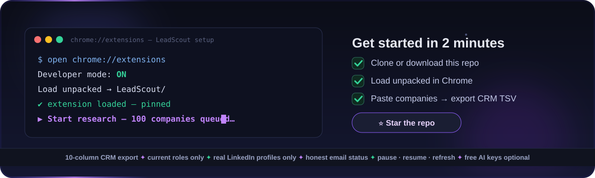

<div align="center">


# LeadScout

Paste a list of companies. Get the decision-makers back as one clean CSV —
names, roles, emails, LinkedIn profiles. Chrome and Edge, everything runs in your browser.

[](LICENSE)
[](https://developer.chrome.com/docs/extensions/)
[](https://www.microsoft.com/edge)

[Install](#install) · [The CSV](#the-output) · [Keys](#keys-all-optional) · [How it stays accurate](#accuracy-rules-enforced-in-code)

</div>

<div align="center">

</div>

<div align="center">

</div>

## What it does

You have companies. You need the people who can say yes to AI, software, automation or digital-transformation work.

- Paste 50–100 companies — LinkedIn URLs, plain names, or mixed lines. Duplicates removed.
- Each company is researched on its own: its own Bing searches, its LinkedIn about-page, an optional AI pass. Company A's CEO can never end up under Company B.
- You download one CSV with exactly ten columns. Nothing else comes out.

## The output

```csv
PROSPECT_FIRST_NAME,PROSPECT_LAST_NAME,DESIGNATION,EMAIL_ID,COMPANY_NAME,COMPANY_SIZE,COUNTRY,INDUSTRY_TYPE,WEBSITE_NAME,LINKEDIN_URL
```

- Names are split into first and last for you.
- `EMAIL_ID` is filled when it can be sourced — verified through Hunter.io, or a pattern estimate marked `estimated — unverified`. Otherwise it stays blank.
- `WEBSITE_NAME` is the company's real domain, only when a source-backed site was found.
- `LINKEDIN_URL` only ever contains a real person profile (`/in/`, `/pub/`) that showed up in search. Never guessed. Never a company page. Tracking params stripped.
- "Former CEO at Acme" never comes back as a current role — past-role rows are dropped before export.
- Blank means blank. No filler rows.

<div align="center">

</div>

## Workspace (side panel)

Research a list of companies, or work the page you are already on. Both end in the same ten columns.

Press the **▤** button in the popup header, or right-click any page and choose **Extract prospect to LeadScout**. The workspace opens as a Chrome/Edge side panel, so it stays visible while you browse.

| Action | What it reads |
|---|---|
| **⌖ Extract current page** | A LinkedIn profile (`/in/`), a LinkedIn people-search or list page, or a company team/about page — including JSON-LD `Person`/`Organization`, team cards, `mailto:` links and `linkedin.com/in/` anchors |
| **Right-click → Extract prospect** | Your text selection ("Asha Shah — CTO at Acme Corp", or name / role / company on separate lines), plus the page it came from |
| **＋ Row** | An empty row you type into |
| **↯ Resolve missing** | Fills only blank `LINKEDIN_URL` cells, one paced lookup at a time |

The table itself:

- Sticky header with the exact ten columns, every cell editable in place.
- A **link icon** on `WEBSITE_NAME` and `LINKEDIN_URL`; both open in a new tab.
- Dedupe by profile URL first, then email + name. Re-extracting the same page fills blanks instead of adding duplicates.
- Rows persist in `chrome.storage.local`, so a browser restart does not lose your table.
- **⤓ CSV** downloads RFC-4180 CSV with a UTF-8 BOM; **⧉ Copy TSV** pastes straight into Sheets or Excel. Both use the same ten headers.

### How a missing LinkedIn URL is resolved

1. **Direct** — the extractor already found a `/in/` or `/pub/` anchor next to that person. Shown as **Verified Direct**.
2. **Search** — a paced Bing lookup for `site:linkedin.com/in/ "First Last" "Company"` (designation if company is blank). A result is accepted only when its own title or snippet contains every name token. Shown as **Auto-Resolved**.
3. **Fallback** — nothing credible found: the cell stays empty, a **Needs Review** / **Verify** badge links to a search you can check yourself, and you can paste the URL by hand.

Lookups are serialized and spaced ~1.9 s apart. If Bing raises a captcha or consent screen the resolver stops and tells you, instead of hammering the page. No profile URL is ever constructed from a name.

## Two exports, one table

| Button | Columns | Use it for |
|---|---|---|
| **⬇ Download CSV** | 10 | Your CRM importer. Exact contract, RFC-4180 quoting, UTF-8 BOM so Excel reads accents correctly. |
| **⬇ Full CSV — every field** | 19 | Audit and hand-off: the ten columns plus `EMAIL_STATUS`, `LINKEDIN_SOURCE`, `HQ`, `COMPANY_LINKEDIN_URL`, `ROLE_CURRENCY`, `PRIORITY`, `VERIFICATION`, `EVIDENCE_URL`, `SOURCE_TYPE`. |
| **⌗ Copy TSV for Excel** | 10 | Pasting. If Excel drops a CSV into one column (a regional delimiter setting), this always lands in cells. |

Every value is quoted the moment it contains a comma, a quote or a line break, so `Managing Director & CEO, Godrej Consumer Products` stays in **DESIGNATION** and never shifts the row. Both files come from the same row model — the CSV and TSV cannot drift apart.

## Install

1. `chrome://extensions` → **Developer mode** → **Load unpacked** → this folder. (Edge: same folder via `edge://extensions`.)
2. Pin LeadScout. Stay logged into LinkedIn in that browser.
3. Paste companies → **Start research** (or Ctrl+Enter) → **Download CSV**. For page-by-page work, open the **▤** workspace and press **Extract current page**.

Quick mode ≈10 s per company, Standard ≈15–25 s, Deep ≈25–40 s. The queue runs in the background — close the popup and keep working. Pause / Resume / Stop / Retry / Refresh-all are all there, and if Bing asks for a human check, the queue pauses itself and resumes when you're done.

## Keys (all optional)

Works with zero keys — public Bing results only. To fill more fields:

| Key | Free at | Adds |
|---|---|---|
| Groq | [console.groq.com](https://console.groq.com) | faster result structuring |
| Gemini | [aistudio.google.com](https://aistudio.google.com) | web-grounded recovery for thin companies |
| OpenRouter | [openrouter.ai](https://openrouter.ai) | free Llama models |
| Hunter.io | [hunter.io](https://hunter.io) | verified emails (~25 domain searches/mo free) |
| Custom | your endpoint | any OpenAI-compatible API |

Settings → **API keys** saves each key into this browser only, with an optional expiry date so you remember to rotate it. There's a Test key button next to every field.

## Accuracy rules (enforced in code)

- A profile URL is kept only if it came from a real search result for that company — or from the company's own leadership page, with the source linked in the UI.
- The AI can only propose people whose names already appear in that company's own results; roles are re-read from the evidence, not taken from the model.
- If a company's own website lists its leadership, those rows are marked **Official** in the UI with the page linked.
- Possibly-past roles are flagged `PAST?` in the results table and never exported.

## Notes

- No server, no analytics, no account. Keys stay in this browser profile and are sent only to their own provider.
- LeadScout reads public search results and public pages at a human pace. Keep volumes reasonable and follow your local privacy law for outreach data.
- Some company sites block automated reads; those rows come back marked "source blocked" rather than guessed.

## Changelog

| Version | What changed |
|---|---|
| **2.4.2** | An export that would contain zero rows is refused with the counts that explain it ("1 companies, 1 people, 0 exportable rows — past-role or under review") instead of silently saving a header-only file. The results page gains **ⓘ Diagnostics**: one JSON with version, queue state and, per company, people vs exportable rows. |
| **2.4.1** | A blank screen can no longer happen silently: uncaught errors and rejected promises raise a readable banner, every button binds defensively (a missing element is skipped, not fatal), and an export with zero exportable rows is refused with a reason instead of saving a header-only file. |
| **2.4.0** | Export pass: a **Full CSV (19 columns)** carries email status, LinkedIn source, HQ, company LinkedIn URL, role currency, priority, verification, evidence URL and source; **Copy TSV** pastes into columns when Excel ignores the comma delimiter; the company-link field stopped being validated as a person URL (it was always blank); RFC-4180 round-trip, quoting and no-column-shift are now regression-tested. |
| **2.3.1** | Bug sweep: a page-wide email no longer attaches to every JSON-LD person; `in.linkedin.com` and `www.linkedin.com` are one identity (no duplicate rows, canonical CSV); the resolver circuit breaker clears on Resume; a consent/captcha during resolution now raises a visible notice instead of silently blanking; the panel works at 380px with an internal table scroll; empty rows no longer show a Verify link; “Asha at Acme” is rejected as a name. |
| **2.3.0** | Profile resolution actually returns URLs now. Two bugs fixed: the Bing query `site:linkedin.com/in/ "Name" "Company"` returns **zero** results (a second quoted phrase collapses the set) so the name-only query runs first with the company as a narrower retry; and `chrome.tabs.update` resolves before navigation starts, so the extractor was reading the previous page — navigation now waits for the tab to leave the old document. Research rows also get a bounded resolution pass (6 per company, stops if Bing asks for consent/captcha), and a blank cell now explains itself on hover. |
| **2.2.1** | Official leadership rows now keep the LinkedIn profile link published on the company page. That URL used to be discarded, which is why the CSV column came back empty. The link is never marked verified, and a company-page link is still rejected. |
| **2.2.0** | Side-panel workspace: extract the current LinkedIn profile, people list or company team page; capture a selection from the context menu; edit all ten columns in place; paced LinkedIn URL resolver with Verified Direct / Auto-Resolved / Needs Review; CSV and TSV from one row model. |
| **2.1.1** | Results tables mirror the CSV contract exactly; leaner README and artwork. |
| **2.1.0** | Single 10-column CSV export across popup and results. |

## Development

```bash
node tools/test.mjs           # 93 checks, including the extension import-graph check
node tools/diag_linkcheck.mjs # standalone module-link check
```

```
manifest.json        MV3 config
background.js        queue engine, Bing/LinkedIn/company-page readers, pipeline
popup.html/.css/.js  main UI, key vault, progress, exports
sidepanel.html/.css/.js  wide workspace: capture, edit, resolve, export
content.js           on-page extractor (profile / list / team / selection)
results.html/.js     full-page results view
lib/                 parse · records · rank · ai · hunter · extract · keys · platform · verify-lead
assets/              animated SVG previews
tools/               tests and helpers
```

<div align="center">

</div>

<div align="center">

</div>

<div align="center">

</div>

<div align="center">

Built by [siddhant-pardeshi](https://github.com/siddhant-pardeshi) · MIT — see [LICENSE](LICENSE)

</div>
