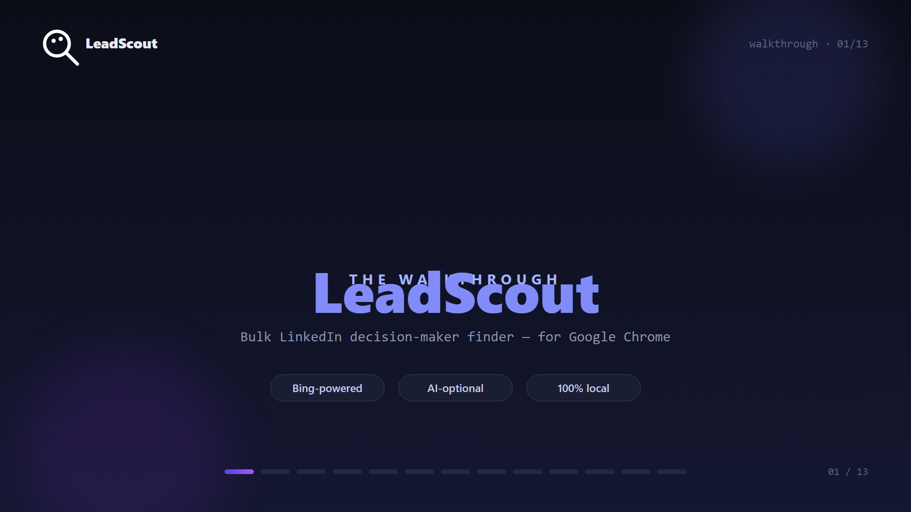

<div align="center">


# LeadScout

**Research 50–100 companies in one click. Get decision-makers — current roles, verified profile links, emails — straight into Microsoft Excel as TSV.**

A Chrome extension that replaces the one-company-at-a-time ChatGPT workflow for B2B lead research.
Runs 100% locally in your browser · powered by **Microsoft Bing** · AI-optional (free keys) · zero data leaves your machine except your own searches.

[](https://developer.chrome.com/docs/extensions/)
[](https://github.com/siddhant-pardeshi/LeadScout/releases)
[](#-testing--quality)
[](LICENSE)
[](https://www.bing.com)

</div>

<div align="center">

</div>

---

<div align="center">

</div>

## 🎬 The story in 30 seconds

You're a business developer. You have **50 companies** to research. The old way:
open a LinkedIn page → copy a prompt into ChatGPT → wait → copy results → repeat ×50,
then pray the AI didn't mix Company A's CEO into Company B's sheet.

**LeadScout does all 50 in one run:**

1. **Paste** — LinkedIn URLs, plain company names, or a mix — one per line
2. **It researches each company in complete isolation** — its own Bing searches, its own
   LinkedIn page read, its own AI call — so names *never* bleed between companies
3. **It verifies before it shows** — profile URLs only from real search results,
   current roles only (past roles are dropped), company facts from the live page
4. **One click → Excel** — a full 14-column TSV lands on your clipboard

<div align="center">

</div>

## 🎬 Video walkthrough — every feature, explained

<div align="center">

<a href="docs/walkthrough.mp4"></a>

**▶ [Watch the walkthrough — 4 minutes, with voice-over](docs/walkthrough.mp4)**

A friendly guided tour of *every* feature: install → bulk input → the research engine →
current-roles engine → verification → emails → one-click Excel export → background controls →
free API keys. **Captions:** [`docs/walkthrough.srt`](docs/walkthrough.srt)

</div>

---

## ✨ Every feature, explained simply

### 🔍 Research engine
| Feature | What it means for you |
|---|---|
| **Bulk input** | Paste 50–100 companies at once — LinkedIn URLs, plain names ("Freshworks"), or mixed lines (`Postman - https://…`). Duplicates removed automatically |
| **Name→page resolution (3 tiers)** | Typed a company name? LeadScout guesses the LinkedIn page slug and *verifies it by loading the page* (never fabricates), then falls back to scored Bing resolution with recall-friendly matching — "Zoho Corporation" correctly finds the page titled "Zoho" |
| **Per-company isolation** | Each company gets its own search corpus and its own AI call. The #1 bulk-research bug — companies mixing into each other — is impossible by design |
| **Deep page scan** | Reads the LinkedIn **`/about/` page** (the data-rich one) for industry, company size, headquarters and website — with retries that ride out LinkedIn's slow rendering, and a guest-mode fallback |
| **3 scan depths** | Quick (1 search), Standard (2), Deep (4) — from ~10 s to ~40 s per company |
| **⟳ Refresh all — latest data** | One button re-runs every researched company so names, roles, facts and emails reflect the *live* web right now |

### 👤 People & designations
| Feature | What it means for you |
|---|---|
| **Current roles only** | A person is kept only with a **current** role at that company. Past markers ("Former CEO", "was CTO", "Ex-Founder") are dropped — even positionally-aware: "Acme Corp engineer, *previously at Google*" is kept; "*Former* CEO at Acme" is not |
| **P1–P5 priority ranking** | P1 = C-suite/founders/CTO/CIO/Chief-AI · P2 = heads of Product/Engineering/AI/Digital · down to managers — encoded from the full B2B designation list |
| **Smart title parsing** | Handles `"Jane Doe - CEO at Acme \| LinkedIn"`, `"Jane Doe CEO at Acme"`, affiliation-only rows and junk rows (`followers`, `on LinkedIn:` posts) |
| **AI enrichment (optional)** | Groq / Gemini / OpenRouter / any OpenAI-compatible endpoint structures the results and fills company facts. **Corpus-gated:** every AI-proposed person must be named in that company's own search results, and their role is re-derived from that result — invented or out-of-company names are dropped and reported. URLs must exist verbatim in the corpus |
| **Gemini web-grounding** | When a company yields thin results, Gemini (free tier) performs real Google-search grounding to recover people and facts |

### 📧 Emails
| Feature | What it means for you |
|---|---|
| **Hunter.io integration (optional, free)** | Paste a free Hunter key → each person is matched against emails Hunter has verified for that domain (`verified via Hunter.io`), falling back to Hunter's domain-verified pattern |
| **Pattern estimation (always available)** | No key? `first.last@domain` (+ 5 alternates) is estimated from the company's *verified* website domain and always labeled `estimated — unverified` |
| **Never fabricated** | No verified source → the cell stays empty. The extension will not invent an address |

### 📋 Excel export
| Feature | What it means for you |
|---|---|
| **One-click TSV** | A single hero button copies the full 14-column TSV — paste straight into Excel |
| **14 columns** | Name · Designation · Country · Company Name · Company Size · Industry · LinkedIn URL · Email · Email Status · Role Currency · Priority · Verification · HQ · Company Page |
| **Core 7-column mode** | Matches the classic research template exactly (`Name, Designation, Country, Company Name, Company Size, Industry, LinkedIn URL`) |
| **Filter-aware export** | Filter to C-Suite or Verified-only, then copy *exactly that* |
| **.TSV / .CSV downloads** | CSV ships with a UTF-8 BOM so names like "José García" open perfectly in Excel |

### 🧭 Verification policy — enforced in code, not a promise
| Label | Meaning |
|---|---|
| 🟢 **Verified** | LinkedIn profile URL came from a real Bing result or Gemini citation for *that specific company* — never constructed |
| 🟢 **CURRENT** | Role at this company is title-verified |
| 🟡 **SNIPPET** | Company seen in the snippet, no past-role markers |
| 🟡 **Unverified** | Real person from search snippets, no pinned profile URL |
| 🔴 **PAST?** | Contradictory signals — shown for manual review, ranked last |
| 🔵 `estimated` | Email is a pattern guess — verify before outreach |

### 🎛 Comfort features
- Live progress with stat tiles (People / Verified / Companies / Remaining) and ETA
- Pause / Resume / Stop / **Retry failed** / **Refresh all**
- Bing captcha? LeadScout **pauses itself**, notifies you, and resumes after you solve it
- Survives Chrome killing the background worker — the queue auto-resumes
- Dark & light themes, animated UI, full-page results view with filters
- AI **model ids are editable** in Settings — when a provider rotates models, you fix it in 5 seconds, no reinstall

---

## 🚀 Install in 2 minutes

1. Download/clone this repo
2. Chrome → `chrome://extensions` → enable **Developer mode** (top-right)
3. **Load unpacked** → select the repo folder
4. Pin **LeadScout** from the puzzle-piece menu
5. *(Optional but recommended)* ⚙ → paste a free API key (below) → **Test key** → Save
6. Log into LinkedIn in the same Chrome profile → paste companies → **▶ Start research**

> Standard mode ≈ 15–25 s per company, so 100 companies ≈ 25–40 minutes. The queue runs in the background — close the popup, keep the browser open.

## 🔑 Free API keys (all optional)

| Key | Get it free | What it adds |
|---|---|---|
| **Groq** *(default AI)* | [console.groq.com](https://console.groq.com) | Fast structuring + fact enrichment |
| **Gemini** | [aistudio.google.com](https://aistudio.google.com) | Adds real **Google-search grounding** for weak results |
| **OpenRouter** | [openrouter.ai](https://openrouter.ai) | Free Llama models |
| **Hunter.io** | [hunter.io](https://hunter.io) | **Real emails** — 25 verified domain searches/month |

No keys at all? LeadScout still works — Bing extraction only, same TSV, just fewer filled facts.

## 🧪 Testing & quality

- **43 unit tests** covering input parsing, Bing-redirect decoding, person-title extraction,
  company matching, the 3-tier resolver, role-currency logic, the AI corpus-grounding gate,
  Hunter matching and TSV/CSV builders
  ```bash
  node tools/test.mjs
  ```
- **Evidence evaluation** — a local verifier that only accepts role claims backed by cited,
  dated sources (it abstains instead of guessing):
  ```bash
  node tools/eval-evidence.mjs
  node tools/live-eval-evidence.mjs --offline
  ```
- DOM ids ↔ JS, imports ↔ exports, manifest JSON — cross-checked in CI-style validation
- Security: SSRF-guarded endpoints (localhost/private ranges refused), scheme-checked links,
  DOM-API rendering (no `innerHTML`), keys stored only in `chrome.storage.local`

## 🏗 Architecture

```
LeadScout/
├── manifest.json        Chrome MV3 config
├── background.js        queue engine · Bing/LinkedIn readers · pipeline · rate limiting
├── popup.html/.css/.js  main UI (input, progress, filters, exports, settings)
├── results.html/.js     full-page results view
├── lib/
│   ├── parse.js         pure logic: parsing, resolver, role-currency, TSV/CSV  ← unit-tested
│   ├── rank.js          designation → category/priority engine                  ← unit-tested
│   ├── ai.js            Groq/Gemini/OpenRouter adapters + SSRF-safe URLs
│   ├── verify-lead.js   evidence verifier: cited, dated role claims only
│   ├── hunter.js        Hunter.io domain-search client
│   └── extract.js       DOM extractors injected into Bing/LinkedIn pages
├── assets/              animated SVG artwork (SMIL — the animations you're seeing)
└── tools/               test suite + icon generator
```

## ⏱ Timing

| Mode | Searches / company | ≈ time / company | 100 companies |
|---|---|---|---|
| Quick | 1 | 8–12 s | ~15–20 min |
| **Standard** | 2 | 15–25 s | ~25–40 min |
| Deep | 4 | 25–40 s | ~50–65 min |

## ❓ Troubleshooting

| Symptom | Fix |
|---|---|
| "Bing needs human verification" | Open any Bing tab, solve the check, click **Resume** |
| LinkedIn facts empty | Stay logged into LinkedIn; keep *Read LinkedIn pages* ON |
| "model not found" from AI | ⚙ → AI models → set the provider's current model id |
| A company needs manual review | Too few public results — try **Deep** mode or the exact LinkedIn URL |

## 🛡 Responsible use

LeadScout reads **public search results and public pages you can already see**, at human-like
pace, through your own session. It deliberately does not mass-scrape employee lists. Keep volumes
moderate (the built-in pacing exists for this), and comply with local privacy law (GDPR/DPDP…)
when storing or contacting people. Emails are pattern estimates unless Hunter-verified — confirm
before first contact.

## 📜 Changelog

| Version | Highlights |
|---|---|
| **1.4.1** | Service-worker recovery (the "status code: 15" dead-end now self-heals + shows a fix banner), Gemini model-id override honored in path/test, **AI corpus-grounding gate** (ungrounded AI names dropped, roles re-derived from evidence), evidence verifier + 11-claim evaluation runner |
| **1.4.0** | Security (scheme-guarded links), render dirty-checks (no UI lag), worker-tab cleanup, **⟳ Refresh all**, AI model overrides, Hunter pattern fix, directory-handle filter |
| 1.3.0 | **Current roles only** (Role Currency engine), Hunter.io real emails, one-click 14-column TSV, filter-aware exports |
| 1.2.0 | 3-tier name→page resolver, JSON-LD/`og:` fallbacks, `/about/` deep scan, UI redesign |
| 1.1.0 | Self-contained extractors, Bing consent retries, precision title parsing, size-from-snippets |
| 1.0.0 | First release: bulk queue, Bing SERP people extraction, TSV export |

<div align="center">

</div>

<div align="center">

</div>

<div align="center">

### 🎥 Prefer watching? [▶ Play the 4-minute walkthrough](docs/walkthrough.mp4)

**Built by [siddhant-pardeshi](https://github.com/siddhant-pardeshi)**

⭐ Star this repo if it saved you an afternoon of copy-pasting — it genuinely helps.

MIT © 2026 — see [LICENSE](LICENSE)

</div>
