<div align="center">


# LeadScout

Paste a list of companies. Get the decision-makers back as one clean CSV —
names, roles, emails, LinkedIn profiles. Chrome and Edge, everything runs in your browser.

[](LICENSE)
[](https://developer.chrome.com/docs/extensions/)
[](https://www.microsoft.com/edge)

[Install](#install) · [The CSV](#the-output) · [Keys](#keys-all-optional) · [How it stays accurate](#accuracy-rules-enforced-in-code)

</div>

<div align="center">

</div>

<div align="center">

</div>

## What it does

You have companies. You need the people who can say yes to AI, software, automation or digital-transformation work.

- Paste 50–100 companies — LinkedIn URLs, plain names, or mixed lines. Duplicates removed.
- Each company is researched on its own: its own Bing searches, its LinkedIn about-page, an optional AI pass. Company A's CEO can never end up under Company B.
- You download one CSV with exactly ten columns. Nothing else comes out.

## The output

```csv
PROSPECT_FIRST_NAME,PROSPECT_LAST_NAME,DESIGNATION,EMAIL_ID,COMPANY_NAME,COMPANY_SIZE,COUNTRY,INDUSTRY_TYPE,WEBSITE_NAME,LINKEDIN_URL
```

- Names are split into first and last for you.
- `EMAIL_ID` is filled when it can be sourced — verified through Hunter.io, or a pattern estimate marked `estimated — unverified`. Otherwise it stays blank.
- `WEBSITE_NAME` is the company's real domain, only when a source-backed site was found.
- `LINKEDIN_URL` only ever contains a real person profile (`/in/`, `/pub/`) that showed up in search. Never guessed. Never a company page. Tracking params stripped.
- "Former CEO at Acme" never comes back as a current role — past-role rows are dropped before export.
- Blank means blank. No filler rows.

<div align="center">

</div>

## Install

1. `chrome://extensions` → **Developer mode** → **Load unpacked** → this folder. (Edge: same folder via `edge://extensions`.)
2. Pin LeadScout. Stay logged into LinkedIn in that browser.
3. Paste companies → **Start research** (or Ctrl+Enter) → **Download CSV**.

Quick mode ≈10 s per company, Standard ≈15–25 s, Deep ≈25–40 s. The queue runs in the background — close the popup and keep working. Pause / Resume / Stop / Retry / Refresh-all are all there, and if Bing asks for a human check, the queue pauses itself and resumes when you're done.

## Keys (all optional)

Works with zero keys — public Bing results only. To fill more fields:

| Key | Free at | Adds |
|---|---|---|
| Groq | [console.groq.com](https://console.groq.com) | faster result structuring |
| Gemini | [aistudio.google.com](https://aistudio.google.com) | web-grounded recovery for thin companies |
| OpenRouter | [openrouter.ai](https://openrouter.ai) | free Llama models |
| Hunter.io | [hunter.io](https://hunter.io) | verified emails (~25 domain searches/mo free) |
| Custom | your endpoint | any OpenAI-compatible API |

Settings → **API keys** saves each key into this browser only, with an optional expiry date so you remember to rotate it. There's a Test key button next to every field.

## Accuracy rules (enforced in code)

- A profile URL is kept only if it came from a real search result for that company — or from the company's own leadership page, with the source linked in the UI.
- The AI can only propose people whose names already appear in that company's own results; roles are re-read from the evidence, not taken from the model.
- If a company's own website lists its leadership, those rows are marked **Official** in the UI with the page linked.
- Possibly-past roles are flagged `PAST?` in the results table and never exported.

## Notes

- No server, no analytics, no account. Keys stay in this browser profile and are sent only to their own provider.
- LeadScout reads public search results and public pages at a human pace. Keep volumes reasonable and follow your local privacy law for outreach data.
- Some company sites block automated reads; those rows come back marked "source blocked" rather than guessed.

## Development

```bash
node tools/test.mjs           # 76 checks, including the extension import-graph check
node tools/diag_linkcheck.mjs # standalone module-link check
```

```
manifest.json        MV3 config
background.js        queue engine, Bing/LinkedIn/company-page readers, pipeline
popup.html/.css/.js  main UI, key vault, progress, exports
results.html/.js     full-page results view
lib/                 parse · rank · ai · hunter · extract · keys · platform · verify-lead
assets/              animated SVG previews
tools/               tests and helpers
```

<div align="center">

</div>

<div align="center">

</div>

<div align="center">

</div>

<div align="center">

Built by [siddhant-pardeshi](https://github.com/siddhant-pardeshi) · MIT — see [LICENSE](LICENSE)

</div>
